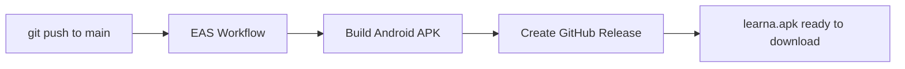

<div align="center">

# Learna

### Prep with purpose.

Last-minute interview prep in your pocket. Short, focused modules across 50+ languages, frameworks and tools, built for the night before the interview.

<br />

[](https://expo.dev)
[](https://reactnative.dev)
[](https://www.typescriptlang.org)
[](https://supabase.com)
[](https://www.nativewind.dev)
[](LICENSE)

<br />

[**Download the latest APK**](https://github.com/Viki2601/learna-mobile/releases/latest/download/learna.apk)
&nbsp;·&nbsp;
[Report a bug](https://github.com/Viki2601/learna-mobile/issues)
&nbsp;·&nbsp;
[Request a feature](https://github.com/Viki2601/learna-mobile/issues)

</div>

---

## Table of contents

- [About](#about)
- [Features](#features)
- [Tech stack](#tech-stack)
- [Getting started](#getting-started)
- [Environment variables](#environment-variables)
- [Project structure](#project-structure)
- [Scripts](#scripts)
- [Build and release](#build-and-release)
- [Roadmap](#roadmap)
- [Author](#author)
- [License](#license)

---

## About

Most interview prep resources teach you a topic from scratch. **Learna** does the opposite: it assumes you already know the material and helps you **revise it fast**.

Every topic is a short module with a clear concept, a key takeaway and a working code example, so you can refresh a subject in minutes instead of hours.

> Example module: **JavaScript → Closures & Scope** (Beginner, 16 questions), each answer with an explanation, a highlighted key takeaway and a code snippet.

---

## Features

| | Feature | Description |
|---|---|---|
| 📚 | **Topic library** | 50+ languages, frameworks and tools (JavaScript, React, Python, SQL, Docker, Git, AWS and more) organized into focused modules |
| 🎯 | **Difficulty levels** | Modules are grouped from Beginner to Advanced so you can match your prep to the role |
| 💡 | **Concept + example** | Each question has a clear answer, a *Key takeaway* callout and a code example |
| 🔐 | **Authentication** | Sign up, log in and password reset, backed by Supabase Auth |
| 🚀 | **Onboarding** | Pick your professional status and learning goal (job search, skill growth or quick revision) |
| 👤 | **Profile and settings** | Name, phone, GitHub, portfolio, technologies, profile photo and learning preferences |
| 🛡️ | **Account control** | Log out, deactivate, or permanently delete your account and profile data from inside the app |
| 🌗 | **Automatic theme** | Follows the device's light or dark setting |

---

## Tech stack

| Layer | Technology |
|---|---|
| Framework | [Expo](https://expo.dev) and [React Native](https://reactnative.dev) |
| Language | [TypeScript](https://www.typescriptlang.org) |
| Routing | [Expo Router](https://docs.expo.dev/router/introduction) with file-based and typed routes |
| Styling | [NativeWind](https://www.nativewind.dev) (Tailwind CSS for React Native) |
| Backend | [Supabase](https://supabase.com): Auth, Postgres database and Storage for profile photos |
| Performance | React Compiler enabled |
| Testing | [Jest](https://jestjs.io) |
| Linting | ESLint |
| CI/CD | [EAS Build](https://docs.expo.dev/build/introduction) and [EAS Workflows](https://docs.expo.dev/eas/workflows/get-started) |

---

## Getting started

### Prerequisites

- [Node.js](https://nodejs.org) (LTS)
- [Git](https://git-scm.com)
- An [Expo](https://expo.dev) account (only needed for cloud builds)
- A [Supabase](https://supabase.com) project
- Android Studio or a physical device for testing

### Installation

```bash
# 1. Clone the repository
git clone https://github.com/Viki2601/learna-mobile.git
cd learna-mobile

# 2. Install dependencies
npm install

# 3. Create your environment file (see the next section)
#    then start the dev server
npx expo start
```

From the terminal output you can open the app in:

- a [development build](https://docs.expo.dev/develop/development-builds/introduction/)
- an [Android emulator](https://docs.expo.dev/workflow/android-studio-emulator/)
- an [iOS simulator](https://docs.expo.dev/workflow/ios-simulator/)
- [Expo Go](https://expo.dev/go), a limited sandbox for quick tests

---

## Environment variables

Create a `.env` file in the project root. It is gitignored and never committed.

```env
EXPO_PUBLIC_SUPABASE_URL=your-supabase-project-url
EXPO_PUBLIC_SUPABASE_ANON_KEY=your-supabase-anon-key
```

> **Note:** Variables starting with `EXPO_PUBLIC_` are bundled into the app, so only use public keys such as the Supabase *anon* key. Never put a service-role key in the client.

For cloud builds, add the same variables in the Expo dashboard under **Project → Environment variables** for the matching environment (`preview` or `production`).

---

## Project structure

```text
learna-mobile/
├── .eas/workflows/      # EAS Workflows (automated builds)
├── assets/              # Icons, fonts, splash and images
├── docs/                # Project documentation
├── scripts/             # Helper scripts
├── supabase/            # Supabase config and database setup
├── src/
│   ├── app/             # Screens (Expo Router)
│   │   ├── (auth)/      #   Login, sign up, forgot password
│   │   ├── (onboarding)/#   First-run preferences
│   │   └── (tabs)/      #   Main app tabs
│   ├── components/ui/   # Reusable UI (Button, AppText, ...)
│   ├── context/         # React context (AuthContext)
│   ├── services/        # Supabase and API logic (auth, profile, account)
│   └── types/           # Shared TypeScript types
├── app.json             # Expo app configuration
├── eas.json             # EAS build profiles
└── tailwind.config.js   # NativeWind / Tailwind theme
```

---

## Scripts

| Command | What it does |
|---|---|
| `npx expo start` | Start the development server |
| `npx expo start --clear` | Start and clear the Metro cache |
| `npx expo lint` | Run ESLint |
| `npx jest` | Run the unit tests |
| `eas build --platform android --profile preview` | Build an installable APK in the cloud |

---

## Build and release

Builds run on Expo's servers, so nothing needs to be compiled on your machine.

### Build profiles (`eas.json`)

| Profile | Output | Use |
|---|---|---|
| `development` | Dev client | Day-to-day development |
| `preview` | APK | Testing and sharing with others |
| `production` | AAB | Google Play Store submission |

### Automated pipeline

Every push to `main` triggers an EAS Workflow that builds the Android APK and attaches it to a GitHub Release.



The newest APK is always available at a fixed link:

```text
https://github.com/Viki2601/learna-mobile/releases/latest/download/learna.apk
```

### Install on Android

1. Download `learna.apk` on your phone from the link above.
2. Open it and allow installs from your browser or file manager if asked.
3. Tap **Install**.

### Manual build

```bash
npm install -g eas-cli
eas login
eas build --platform android --profile preview
```

---

## Roadmap

- [x] Authentication and onboarding
- [x] Topic modules with answers, takeaways and code examples
- [x] Profile, settings and account management
- [x] Automated builds and releases
- [ ] Flashcards with swipe gestures
- [ ] Offline mode
- [ ] Spaced repetition
- [ ] Daily reminders
- [ ] Progress dashboard
- [ ] Google Play Store release

---

## Contributing

Contributions, issues and feature requests are welcome.

1. Fork the project
2. Create a branch: `git checkout -b feature/your-feature`
3. Commit your changes: `git commit -m "Add your feature"`
4. Push the branch: `git push origin feature/your-feature`
5. Open a pull request

---

## Author

**Vishnu Muthukumar**
Frontend Developer · Chennai, India

[](https://github.com/Viki2601)
[](https://vishnumuthukumar.com)

---

## License

Distributed under the MIT License. See [`LICENSE`](LICENSE) for details.

<div align="center">

<sub>Learna · Prep with purpose</sub>

</div>
